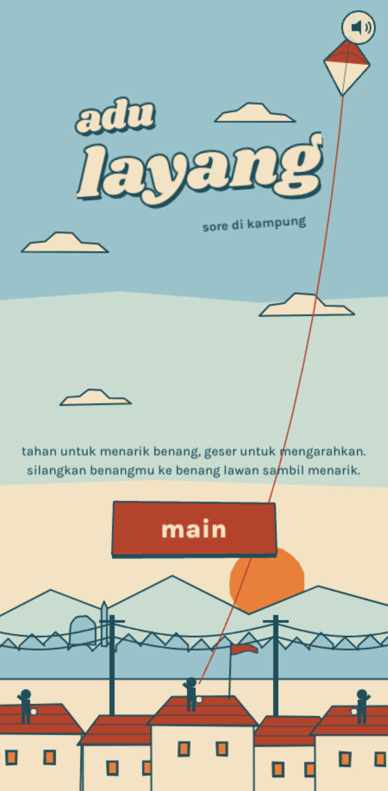

# Adu Layang

*Adu Layang* ("kite fight") is a one-finger kite-fighting game for the browser, made for phones first. Fly your red-and-white kite from a rooftop in the evening sky, dodge the power lines and birds, and cut your neighbours' kite strings. The in-game text is in Indonesian.



## How to play

| Action            | Phone                         | Keyboard / mouse               |
|-------------------|-------------------------------|--------------------------------|
| Pull the string (kite climbs) | Hold the screen     | Hold Space or the mouse button |
| Steer left / right | Slide your finger            | ← → or A / D, or move the mouse |
| Let go (kite sinks and drifts with the wind) | Lift your finger | Release |
| Pause / mute      | Buttons on screen             | P / M                          |

- Touching the power lines or getting hit by a bird snaps your string.
- Cross your string over a rival's string while pulling to cut it. The kite flying higher has the advantage. Lose the duel and your own string wears out (the **BENANG** bar).
- +1 point per second in the air, +100 per cut, multiplied for quick cuts in a row. Three in a row is a **BORONG!** bonus.
- Your best score is saved in your browser.

## Run it locally

No build step. Open `index.html` in a browser, or serve the folder:

```bash
python3 -m http.server 8000
# then open http://localhost:8000
```

## Deploy

It is a static site, so any static host works. On [Vercel](https://vercel.com): **Add New → Project**, import this repository, keep the framework preset as **Other**, leave the build command empty, and deploy. GitHub Pages works too (Settings → Pages → branch `main`, root folder).

## Files

| Path          | What it is |
|---------------|------------|
| `index.html`  | The whole game (Phaser 3.60). The `T` block near the top holds the tuning numbers; art is drawn in code; music and sound are synthesised with Web Audio. |
| `DESIGN.md`   | Design spec with the balance numbers (Indonesian). |
| `qa/test.js`  | Playwright test bot: plays the game, checks each way to lose, and tests touch controls on a phone viewport. Run `npm i playwright && node qa/test.js` (set `PHASER=/path/to/phaser.min.js` if cdnjs is unreachable). |

No third-party assets are used. The only runtime dependency is [Phaser](https://phaser.io/) 3.60, loaded from cdnjs.

## License

[MIT](LICENSE) © 2026 dinamo (dynamolabs)
